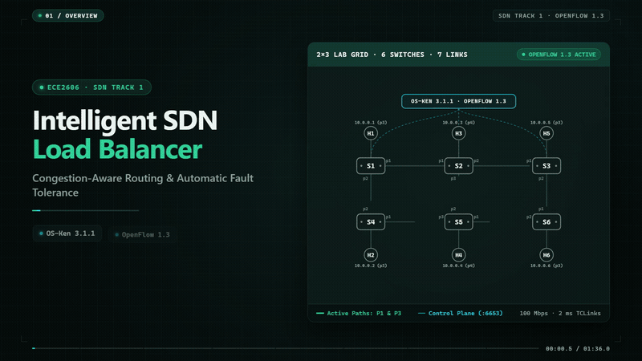
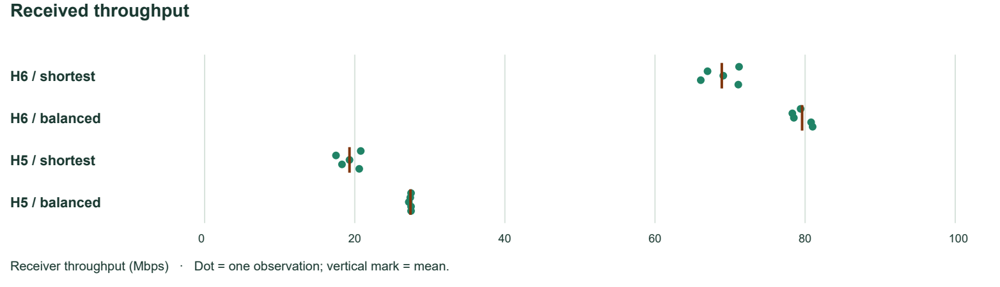

# Intelligent SDN Load Balancer with Fault Tolerance


An OpenFlow 1.3 controller that measures directional link load, identifies sustained large flows, and moves eligible traffic to a better network path. Includes a six-switch grid, a k=4 fat-tree, a local live dashboard, repeatable experiments and the underlying raw results.

**OS-Ken · Mininet · Open vSwitch · Python · OpenFlow 1.3**

[Full video, 96 seconds](#motion-graphics-video-full-96-seconds) · [Arabic Ubuntu run guide](ubuntu/README.md) · [English report PDF](output/report/sdn-track-1-report.pdf) · [Arabic lab and discussion guide](output/pdf/sdn-arabic-lab-guide.pdf) · [Experiment figures](output/pdf/sdn-experiment-results.pdf)

## Motion graphics video, full 96 seconds

**[Download the FULL video: MP4 · 1:36 · 1080p · silent](https://raw.githubusercontent.com/maboora7a652-arch/sdn-load-balancer/master/output/video/sdn-load-balancer-explainer.mp4)**

The complete approved video is stored at [`output/video/sdn-load-balancer-explainer.mp4`](output/video/sdn-load-balancer-explainer.mp4) (14.97 MB). Use the direct download link above; if you open the repository file page, use **Download raw file** to save it and play it locally.

### Short highlights preview, 13.5 seconds

The animation below is a looping GIF assembled from four excerpts. Its jumps are edits in the preview, not missing sections in the full MP4. Click it to download the complete video.

[](https://raw.githubusercontent.com/maboora7a652-arch/sdn-load-balancer/master/output/video/sdn-load-balancer-explainer.mp4)

The revised clip is a **96-second silent motion graphics explainer**. Its main calibration and benchmark cards use the current recorded results, including the separate November 26 calibration. The grid telemetry trace and 79/80 H1-H6 failure illustration are explicitly historical examples. Diagrams animate the control logic; they are not a recording of a live lab run. Fouad approved this revision as supplied. This asset is separate from the course's 5-8 minute live demonstration recording.

[Current numbers and source references](media/video-data.json)

## Project overview

The required grid scenario sends 85 Mbps from H1 to H6 and 30 Mbps from H3 to H5 across S2-S3. When the congestion and improvement conditions hold, the controller moves H1-H6 from P1 (`S1-S2-S3-S6`) to P3 (`S1-S4-S5-S6`). A separate demonstration temporarily cuts S5-S6 and observes forwarding over the surviving path.

- **Discovery:** switch, link and host learning, NetworkX graph, proxy ARP.
- **Monitoring:** port RX/TX, directional utilization, ingress host-pair rates and flow statistics.
- **Selection:** up to three shortest simple paths, projected bottleneck after moving the flow, then hop count and shared-link ties.
- **Update:** higher-priority rules from egress to ingress, matching barrier acknowledgements, then strict deletion of the old rules.
- **Hysteresis:** a 30-second per-flow hold-down and at least 15 percentage points of projected improvement.
- **Observation:** REST on `127.0.0.1:8080`, dashboard on `127.0.0.1:8081`.

A flow is one **directed IPv4 MAC-address pair**, not a separate TCP/UDP five-tuple. The default link capacity is 100 Mbps, inter-switch delay is 2 ms, and HTB burst/cburst is 64k. OS-Ken is the Ryu fork expressly permitted by the course assignment.

## First-time Ubuntu setup

**The `ubuntu/` directory is now the complete standalone network project. Copy that one folder, including all its contents.** It contains the controller, topologies, dashboard, experiments, saved results, C1 capture, dependencies and launch scripts. No runtime source files need to be collected from other repository folders.

### Transfer from Windows

1. On GitHub, choose **Code → Download ZIP** and extract the repository.
2. Copy the extracted **ubuntu** folder to your Ubuntu **Home** directory using a VirtualBox shared folder or USB.
3. Rename that copied folder to **sdn-project**. Do not overwrite an existing project; use the updater below for that case.
4. In a normal Ubuntu terminal, without `sudo`, run:

```bash
bash "$HOME/sdn-project/setup.sh"
```

The setup script installs Ubuntu system packages, including both iperf and iperf3, and creates `~/sdn-lab/.venv` if needed. An existing working controller environment is reused without a pip upgrade. Network access is required to install packages. The recorded lab uses Ubuntu 22.04 / Python 3.10; a complete fresh installation on another machine has not been tested.

The resulting layout is:

```text
~/sdn-project/
    README.md
    setup.sh
    run.sh
    requirements.txt
    vm-source/
    dashboard/
    experiments/          # fixtures and raw results included
    c1/
    install_local.py
    update_local.py
~/sdn-lab/.venv/          # OS-Ken environment
```

After setup, follow [the three-terminal run commands](#run-on-the-configured-ubuntu-vm). The [Arabic guide inside the folder](ubuntu/README.md) explains each file and step. In later sessions, use `run.sh` directly; installation is not a daily step.

### Download directly on Ubuntu instead

You can also clone the repository to a download directory and let setup copy its standalone Ubuntu folder into a new `~/sdn-project`:

```bash
sudo apt update
sudo apt install git
git clone https://github.com/maboora7a652-arch/sdn-load-balancer.git "$HOME/sdn-download"
bash "$HOME/sdn-download/ubuntu/setup.sh"
```

The copy step refuses an existing destination. Reports, video and report/video authoring sources remain in the full repository and are optional for the network runtime. Do not copy Windows virtual environments or dated source checkpoints as active code.

## Update Fouad's existing Ubuntu copy

The working installation remains `~/sdn-project`, with the same launch commands. Moving repository source files into `ubuntu/` does not require reinstalling Fouad's environment. Stop Mininet, the controller and the dashboard, then run from the shared source:

```bash
sudo python3 "/media/sf_sdn_transfer/ubuntu/update_local.py"
```

The updater now reads the standalone Ubuntu folder itself. It saves a differing active controller, keeps differing local raw-result files and retains the existing environment. Reports/media and AI handoff files are also copied when the full repository is present beside this folder; they are not required by the standalone runtime.

```bash
cmp -s "$HOME/sdn-project/README.md" "/media/sf_sdn_transfer/ubuntu/README.md" && echo "README is up to date"
```

Windows edits do not update the VM automatically. The updater does not restart processes or install packages. Actual Ubuntu synchronization remains unconfirmed until it is run there.

## Run on the configured Ubuntu VM

The independent project is `~/sdn-project`; the existing controller environment is `~/sdn-lab/.venv`. Open three terminals, starting the controller first:

```bash
bash ~/sdn-project/run.sh controller grid
```

```bash
bash ~/sdn-project/run.sh network grid
```

```bash
bash ~/sdn-project/run.sh dashboard
```

Open **http://127.0.0.1:8081** inside Ubuntu and select H1 to H6. Wait for six switches and seven links. At the `mininet>` prompt:

```text
pingall
py __import__('runpy').run_path('experiments/grid_demo.py', init_globals=dict(h1=h1,h3=h3,h5=h5,h6=h6)) and None
```

The traffic demonstration lasts about 60 seconds. A successful move ends on `[1,4,5,6]` with priority 21 or higher. `best` is a candidate; `current` is the installed route. Rerouting depends on the measured trigger and improvement conditions.

When H1-H6 is on that managed P3 route, run the long failure demonstration:

```text
py __import__('runpy').run_path('experiments/link_failure_demo.py', init_globals=dict(net=net)) and None
```

It sends roughly 60 seconds of ping, takes S5-S6 down for at least 15 seconds, and restores it. It stops before cutting if the initial route does not match its scenario. The Arabic run guide includes the independent H2-H6 alternative.

To stop, enter `exit` in Mininet and use Ctrl+C in the controller and dashboard terminals. For the fat-tree, restart the first two launchers with `fattree` instead of `grid`, wait for 20 switches and 32 links, and run `pingall 2`.

## Parameters and observation

| Parameter | Default / rule |
| --- | --- |
| Poll interval | 5 seconds; configurable from 2 to 5 |
| Elephant | Ingress rate above 10 Mbps for two periods |
| Congestion | EWMA alpha=0.5, above 70% for two periods |
| Candidate paths | Up to k=3 shortest simple paths |
| Improvement | At least 15 percentage points |
| Hold-down | 30 seconds for each directed pair |
| Dashboard refresh | About 1 second after the preceding request completes |

`SDN_POLL_INTERVAL`, `SDN_CONGESTION_PERCENT` and `SDN_ROUTING_MODE` are read when the controller process starts. Modes are `shortest`, `ecmp` and `balanced`. `SDN_TOPOLOGY` selects `mynetwork` or `fattree4`; the launcher handles these names.

The controller supplies `/topology`, `/links`, `/flows`, `/sdn/status`, `/sdn/hosts` and `/sdn/bandwidth`. Original `/sdn/` topology/links/flows aliases remain available. `/flows` retains switch-local totals and ingress directed-pair details.

## Current recorded results

These are measurements of the saved workloads, not guarantees for every VM or traffic matrix. The repeated November 25 comparisons used 64k HTB shaping before the final November 26 LLDP wait correction. The November 26 calibration is a separate homogeneous five-run batch.

| Experiment | Recorded result | Raw source under `ubuntu/experiments/results/` in this repository |
| --- | --- | --- |
| Latest iperf3 accuracy, n=5 | Mean error **3.116%**, sample SD **0.181 pp** | `accuracy-20261126T124854Z.json` |
| H6 receiver, 85+30 Mbps workload | Shortest **68.90**, balanced **79.60 Mbps** | `compare-grid-20261125T194357Z/` |
| H5 receiver, same workload | Shortest **19.30**, balanced **27.42 Mbps** | Same batch |
| Ten flows, mean peak TX | ECMP **47.96%**, shortest **56.20%**, balanced **56.50%** | `ten-flows-20261125T200721Z/` |
| Recovery, n=5 | First qualifying reply **73.139 ± 21.631 ms**; **7/1300** probes lost | `recovery-20261125T202848Z/` |
| Congestion declaration at 70%, n=5 each | T2 **6.952 s**, T5 **18.932 s** | `shared-detection-20261125T203550Z/` |
| Threshold comparison at T2, n=5 each | 60% **6.815 s**, 80% **8.927 s**; all detected | `threshold-20261125T205244Z/` |
| Before/after moves | **14** paired comparisons across five runs; benefits depend on pair and metric | `route-phases-20261125T210721Z/` |



The plot is generated from raw experiment data. In the separate 90 Mbps before/after batch, H1-H6 throughput was already near 28 Mbps; its RTT decreased while jitter increased. A lower peak, a higher receiver rate and a lower RTT answer different questions.

## Experiments and tests

In a running fat-tree Mininet session:

```text
py __import__('runpy').run_path('experiments/bandwidth_accuracy.py', init_globals=dict(net=net)) and None
```

This starts five 30-second, 5 Mbps UDP trials. The script uses installed iperf3 and preserves stopped runs. A resumed file can combine configurations if code changed between attempts; keep its provenance explicit.

Standalone batches create and clean up their own fresh grids. Stop an interactive Mininet and controller first:

```bash
sudo python3 ~/sdn-project/experiments/compare_grid.py --help
```

Available comparisons include `--ten-flows`, `--recovery`, `--compare-shared-link`, `--compare-thresholds` and `--route-phases`. With no scenario flag, the script compares shortest and balanced under 85+30 Mbps demand.

```bash
python3 ~/sdn-project/experiments/check_logic.py
python3 ~/sdn-project/experiments/check_sync.py
```

The 16 logic tests cover actual method bodies and an exported OS-Ken source fixture, including the bounded LLDP wait. The updater checks separately cover preservation of existing results and controller backups. These are offline regressions, not an emulation of the full OS-Ken/Mininet runtime.

## C1 OpenFlow capture

`ubuntu/c1/` contains the learning-switch source and the original student capture. Open `c1/c1-linear-rerun.pcapng` in Wireshark and use `tcp.port == 6653 && tcp.len > 0`. The capture includes HELLO, FEATURES, table-miss FLOW_MOD, PACKET_IN, forwarding FLOW_MOD and PACKET_OUT. The report explains this sequence using the real capture.

## Limits and remaining course material

- Discovery churn has occurred in extended controller sessions, including supplied logs. A local patch bounds one reproducible indefinite LLDP wait; a complete accuracy batch does not prove that all topology instability is resolved.
- High-load UDP loss is retained in the raw data. The adaptive policy does not improve every workload or every metric.
- The 30-second hold-down is implemented and regression-tested, but its effect has not been isolated in a completed live test.
- Cold-start reachability and rate samples can differ from warmed-up operation. Port TX includes framing and background traffic. Delay results are ping RTT, not one-way latency.
- The six-member roster is confirmed below. Individual contribution attribution and original weekly submissions remain to be completed. Report and presentation submission status should be checked against the course requirements.

## Team

Course coordinator: **Prof. Ahmed M. Abdelhaleem**, as stated in the original course assignment.

| الاسم | Student ID |
| --- | --- |
| عبدالحميد أحمد | 921230064 |
| عبدالرحمن أحمد محمد محمد | 921230066 |
| عبدالرحمن أحمد فؤاد | 921230065 |
| عبدالرحمن عمرو عبدالحليم | 921230069 |
| صهيب وائل محمد | 921230061 |
| عبدالرحمن صلاح الدين يحي | 921230068 |

## Repository layout

```text
ubuntu/             Standalone folder to copy to Linux as ~/sdn-project
ubuntu/setup.sh     First-time dependency setup
ubuntu/run.sh       Controller, network and dashboard launcher
ubuntu/vm-source/   Current controller and topology source
ubuntu/experiments/ Demos, comparisons, fixtures, tests and raw results
ubuntu/dashboard/   Local dashboard and API proxy
ubuntu/c1/          Learning switch and original Wireshark capture
output/report/      Editable combined report and PDF chapters
output/pdf/         Experiment figures and Arabic lab guide
output/video/       Approved explainer, preview and stills
media/              Repository artwork and current video numbers
report_builder/     Current report generator and older authoring helpers
video/              Motion graphics authoring sources
```

`PLAN.md` is the single project plan. `HANDOFF.md` is the short current state for another AI/account. `WORK_LOG.md`, raw results and local Git preserve the history. Dated source archives and checkpoints are historical baselines and must not replace the current `ubuntu/vm-source/` files.

The current combined report is the revised 33-page PDF / 34-page Word edition (`output/report/sdn-track-1-report.pdf` and `.docx`), with a standalone cover and its reconciled offline generator under `report_builder/`. The individual chapter files in `output/report/` are earlier drafts.

Report authoring is separate from the network runtime. Use `report_builder/build_report.py` and `report_builder/export_pdf.ps1` to regenerate the combined Word/PDF report; `report_builder/build_deliverables.py` is the older chapter assembler and is not compatible with this edition's heading structure. Team names and the explainer revision are approved; individual contribution attribution and original weekly submissions remain pending.
