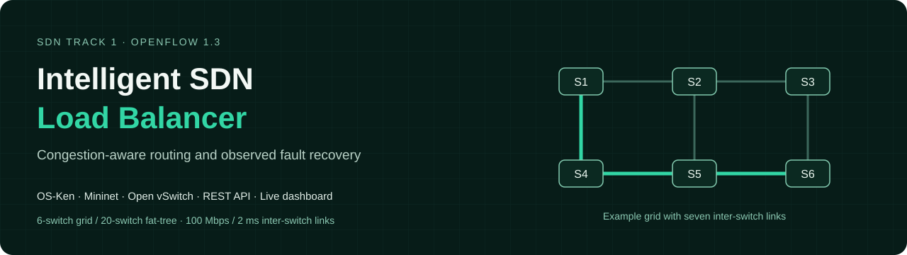

# Intelligent SDN Load Balancer with Fault Tolerance



مشروع Computer Networks: كنترولر SDN يراقب ضغط الشبكة، وينقل التدفقات المؤهلة لمسار أفضل، ويتعامل مع قطع الوصلات. فيه Grid و Fat-tree وداشبورد محلية وتجارب محفوظة.

**OS-Ken · Mininet · Open vSwitch · Python · OpenFlow 1.3**

## ابدأ من هنا

| عايز تعمل إيه؟ | افتح إيه؟ |
| --- | --- |
| أشغّل المشروع الموجود عندي وأعرضه للدكتور | **[التشغيل والديمو على Ubuntu](ubuntu/README.md#demo)** |
| أثبّت المشروع لأول مرة على جهاز جديد | **[Installation على Ubuntu](ubuntu/README.md#install)** |
| أعرف الملفات اللي أنقلها من Windows إلى Ubuntu | [قائمة الملفات وطريقة النقل](ubuntu/README.md#install) |
| أحدّث نسخة Ubuntu الموجودة من الشير | [تحديث النسخة الحالية](ubuntu/README.md#update) |
| أشغّل تجربة مقارنة أو اختبارات إضافية | [التجارب والاختبارات](ubuntu/README.md#experiments) |
| أفهم المشروع وأذاكر للمناقشة | [دليل الشرح العربي PDF](output/pdf/sdn-arabic-lab-guide.pdf) |
| أشوف الفيديو كامل | [الموشن جرافيك، 96 ثانية](#video) |
| أقرأ التقرير الحالي | [التقرير المجمّع PDF](output/report/sdn-track-1-report.pdf) |

**إنت لو المشروع شغّال عندك بالفعل: افتح أول رابط، وابدأ من تشغيل Grid.**

هذه الصفحة فهرس للمشروع. كل أوامر التثبيت والتشغيل والتجارب مجمّعة في [دليل Ubuntu](ubuntu/README.md). في نسخة فؤاد المستقلة يُنسخ نفس الدليل إلى الملف التالي بعد تشغيل المُحدّث:

```text
/home/fouad/sdn-project/README.md
```

<a id="first-time-ubuntu-setup"></a>
<a id="run-on-the-configured-ubuntu-vm"></a>
<a id="update-fouads-existing-ubuntu-copy"></a>

التثبيت مرة واحدة، التشغيل كل مرة تحتاج المشروع، والتحديث عند تغيير ملفات النسخة فقط. تغيير Windows لا يحدّث Ubuntu تلقائيًا.

<a id="video"></a>
<a id="motion-graphics-video-full-96-seconds"></a>

## فيديو الموشن جرافيك

**[نزّل الفيديو الكامل، MP4 · 96 ثانية · 1080p](https://raw.githubusercontent.com/maboora7a652-arch/sdn-load-balancer/master/output/video/sdn-load-balancer-explainer.mp4)**

المعاينة التالية **GIF مختصرة مدتها 13.5 ثانية** من أربعة مشاهد. اضغط عليها لتنزيل الفيديو الكامل:

[](https://raw.githubusercontent.com/maboora7a652-arch/sdn-load-balancer/master/output/video/sdn-load-balancer-explainer.mp4)

الفيديو الكامل صامت وموجود في [output/video](output/video/sdn-load-balancer-explainer.mp4). لو فتحت صفحة الملف على GitHub، استخدم Download raw file. أرقامه الرئيسية من النتائج الحالية، مع أمثلة تاريخية معلّمة مثل trace الشبكة و79/80 ping. هو شرح موشن جرافيك، وليس تسجيل الديمو الحي المطلوب 5–8 دقائق.

## التقرير والشرح

| الملف | استخدامه |
| --- | --- |
| [التقرير المجمّع PDF](output/report/sdn-track-1-report.pdf) | النسخة الحالية، 33 صفحة |
| [التقرير المجمّع Word](output/report/sdn-track-1-report.docx) | النسخة القابلة للتعديل، 34 صفحة بحسب الفهرس المحفوظ |
| [دليل الشرح العربي PDF](output/pdf/sdn-arabic-lab-guide.pdf) | فهم المصطلحات والكود والمناقشة؛ الأوامر الحالية في دليل Ubuntu |
| [رسوم ونتائج التجارب PDF](output/pdf/sdn-experiment-results.pdf) | عرض القياسات والرسوم المسجلة |
| [النتائج الخام](experiments/results) | ملفات التشغيل الأصلية، ومنها المحاولات المتوقفة |
| [مصدر أرقام الفيديو](media/video-data.json) | ربط الأرقام بملفات التجارب |

**استخدم التقرير المجمّع.** ملفات chapter المنفصلة في output/report مسودات أقدم. التقارير الموجودة في جذر المستودع والمكتوب عليها Through C5 و2026-11-17 مراجع تاريخية.

<details>
<summary>كيف يعمل المشروع؟ المعايير والنتائج المسجلة</summary>

## Project overview

The required grid scenario sends 85 Mbps from H1 to H6 and 30 Mbps from H3 to H5 across S2-S3. When the congestion and improvement conditions hold, the controller moves H1-H6 from P1 (`S1-S2-S3-S6`) to P3 (`S1-S4-S5-S6`). A separate demonstration temporarily cuts S5-S6 and observes forwarding over the surviving path.

- **Discovery:** switch, link and host learning, NetworkX graph, proxy ARP.
- **Monitoring:** port RX/TX, directional utilization, ingress host-pair rates and flow statistics.
- **Selection:** up to three shortest simple paths, projected bottleneck after moving the flow, then hop count and shared-link ties.
- **Update:** higher-priority rules from egress to ingress, matching barrier acknowledgements, then strict deletion of the old rules.
- **Hysteresis:** a 30-second per-flow hold-down and at least 15 percentage points of projected improvement.
- **Observation:** REST on `127.0.0.1:8080`, dashboard on `127.0.0.1:8081`.

A flow is one **directed IPv4 MAC-address pair**, not a separate TCP/UDP five-tuple. The default link capacity is 100 Mbps, inter-switch delay is 2 ms, and HTB burst/cburst is 64k. OS-Ken is the Ryu fork expressly permitted by the course assignment.

## Parameters and observation

| Parameter | Default / rule |
| --- | --- |
| Poll interval | 5 seconds; configurable from 2 to 5 |
| Elephant | Ingress rate above 10 Mbps for two periods |
| Congestion | EWMA alpha=0.5, above 70% for two periods |
| Candidate paths | Up to k=3 shortest simple paths |
| Improvement | At least 15 percentage points |
| Hold-down | 30 seconds for each directed pair |
| Dashboard refresh | About 1 second after the preceding request completes |

`SDN_POLL_INTERVAL`, `SDN_CONGESTION_PERCENT` and `SDN_ROUTING_MODE` are read when the controller process starts. Modes are `shortest`, `ecmp` and `balanced`. `SDN_TOPOLOGY` selects `mynetwork` or `fattree4`; the launcher handles these names.

The controller supplies `/topology`, `/links`, `/flows`, `/sdn/status`, `/sdn/hosts` and `/sdn/bandwidth`. Original `/sdn/` topology/links/flows aliases remain available. `/flows` retains switch-local totals and ingress directed-pair details.

## Current recorded results

These are measurements of the saved workloads, not guarantees for every VM or traffic matrix. The repeated November 25 comparisons used 64k HTB shaping before the final November 26 LLDP wait correction. The November 26 calibration is a separate homogeneous five-run batch.

| Experiment | Recorded result | Raw source under `experiments/results/` |
| --- | --- | --- |
| Latest iperf3 accuracy, n=5 | Mean error **3.116%**, sample SD **0.181 pp** | `accuracy-20261126T124854Z.json` |
| H6 receiver, 85+30 Mbps workload | Shortest **68.90**, balanced **79.60 Mbps** | `compare-grid-20261125T194357Z/` |
| H5 receiver, same workload | Shortest **19.30**, balanced **27.42 Mbps** | Same batch |
| Ten flows, mean peak TX | ECMP **47.96%**, shortest **56.20%**, balanced **56.50%** | `ten-flows-20261125T200721Z/` |
| Recovery, n=5 | First qualifying reply **73.139 ± 21.631 ms**; **7/1300** probes lost | `recovery-20261125T202848Z/` |
| Congestion declaration at 70%, n=5 each | T2 **6.952 s**, T5 **18.932 s** | `shared-detection-20261125T203550Z/` |
| Threshold comparison at T2, n=5 each | 60% **6.815 s**, 80% **8.927 s**; all detected | `threshold-20261125T205244Z/` |
| Before/after moves | **14** paired comparisons across five runs; benefits depend on pair and metric | `route-phases-20261125T210721Z/` |


The plot is generated from raw experiment data. In the separate 90 Mbps before/after batch, H1-H6 throughput was already near 28 Mbps; its RTT decreased while jitter increased. A lower peak, a higher receiver rate and a lower RTT answer different questions.

</details>

## مكان كل حاجة

| المكان | محتواه |
| --- | --- |
| [vm-source](vm-source) | كود الكنترولر والتوبولوجي الحالي |
| [dashboard](dashboard) | الداشبورد وخادمها المحلي |
| [experiments](experiments) | الديموهات والتجارب واختبارات المنطق؛ النتائج في results |
| [ubuntu](ubuntu) | دليل الأوامر وملف التشغيل وأدوات التثبيت والتحديث |
| [c1](c1) | learning switch والتقاط Wireshark الأصلي |
| [output](output) | التقرير والشرح والرسوم والفيديو الجاهز |
| [report_builder](report_builder) و [video](video) | مصادر تأليف التقرير والفيديو، لو هتعدلهم |
| [media](media) | صور صفحة GitHub وملفات بيانات الفيديو |

<details>
<summary>الأرشيف القديم ومصادر التأليف، للمطور فقط</summary>

الأرشيف sdn-python-source-20261117-190113.tar.gz ومجلده المستخرج، ومجلد sdn وملفات success وbefore نسخ تاريخية. كود التشغيل الحالي في vm-source؛ لا تستبدله بنسخة من الأرشيف.

مولّد التقرير الحالي في report_builder/build_report.py و report_builder/export_pdf.ps1. experiments/build_deliverables.py مجمّع الفصول القديم وغير متوافق مع نسخة التقرير المجمّع الحالية. مصادر الفيديو في video؛ الفيديو الجاهز في output/video.

</details>

## حالة المشروع وحدوده

- Discovery churn has occurred in extended controller sessions, including supplied logs. A local patch bounds one reproducible indefinite LLDP wait; a complete accuracy batch does not prove that all topology instability is resolved.
- High-load UDP loss is retained in the raw data. The adaptive policy does not improve every workload or every metric.
- The 30-second hold-down is implemented and regression-tested, but its effect has not been isolated in a completed live test.
- Cold-start reachability and rate samples can differ from warmed-up operation. Port TX includes framing and background traffic. Delay results are ping RTT, not one-way latency.
- The six-member roster is confirmed below. Individual contribution attribution and original weekly submissions remain to be completed. Report and presentation submission status should be checked against the course requirements.

<details>
<summary>الفريق ومنسق المادة</summary>

Course coordinator: **Prof. Ahmed M. Abdelhaleem**, as stated in the original course assignment.

| الاسم | Student ID |
| --- | --- |
| عبدالحميد أحمد | 921230064 |
| عبدالرحمن أحمد محمد محمد | 921230066 |
| عبدالرحمن أحمد فؤاد | 921230065 |
| عبدالرحمن عمرو عبدالحليم | 921230069 |
| صهيب وائل محمد | 921230061 |
| عبدالرحمن صلاح الدين يحي | 921230068 |

</details>

## لو هتعدّل الكود أو تسلّم المشروع لـAI آخر

ابدأ بـ[HANDOFF.md](HANDOFF.md) للحالة والخطوة التالية، و[PLAN.md](PLAN.md) للخطة، و[AGENTS.md](AGENTS.md) لتعليمات العمل. التاريخ في [WORK_LOG.md](WORK_LOG.md)، والحدود في [ISSUES_AND_RISKS.md](ISSUES_AND_RISKS.md). يمكن نسخ [برومبت الاستلام](WORK_START_PROMPT_AR.md) لبدء محادثة جديدة.

المساهمات الفردية وتقارير الأسابيع والعرض وتسجيل الديمو الحي ليست كلها مؤكدة الاكتمال. لا تمثل صفحة GitHub وحدها اكتمال تسليم المقرر.
